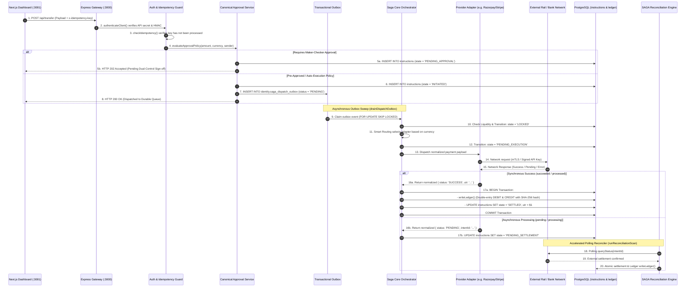
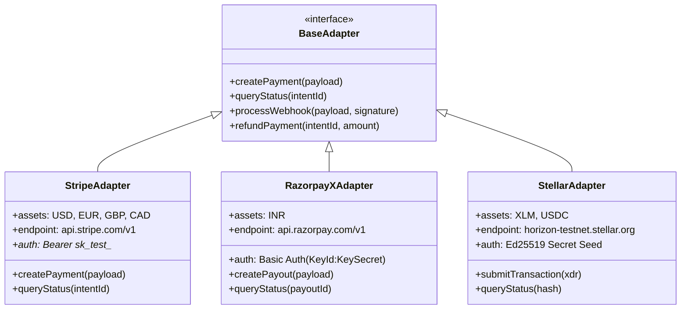
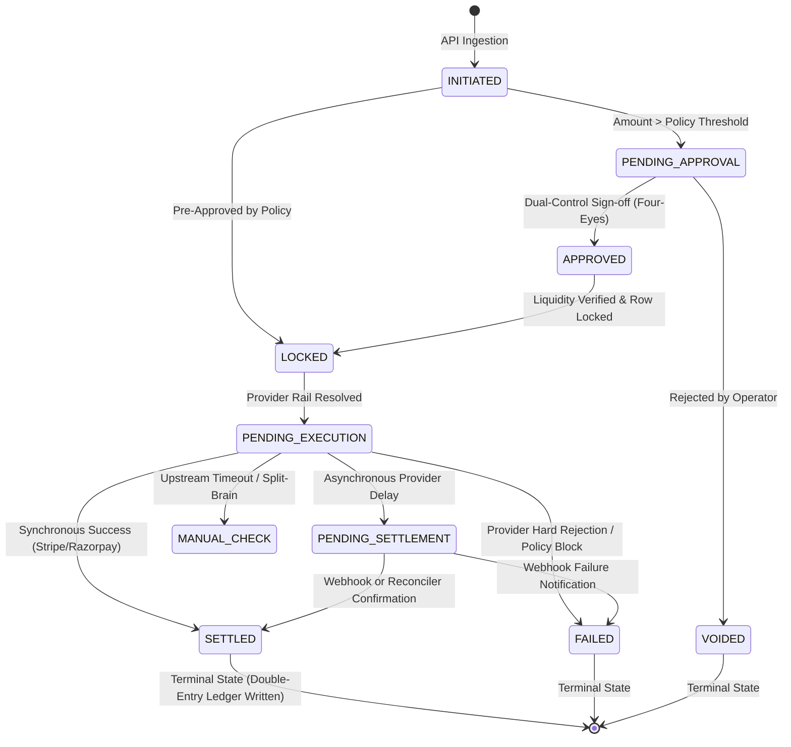
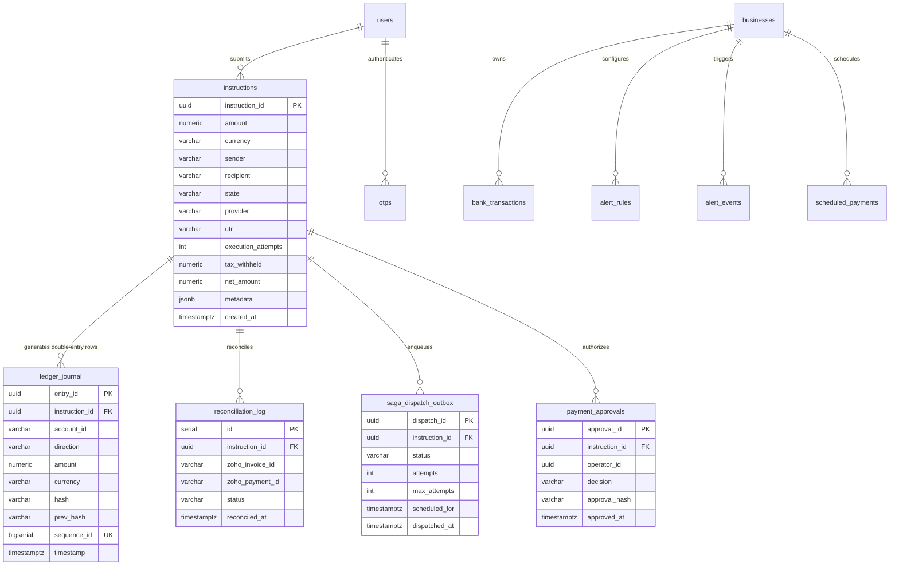
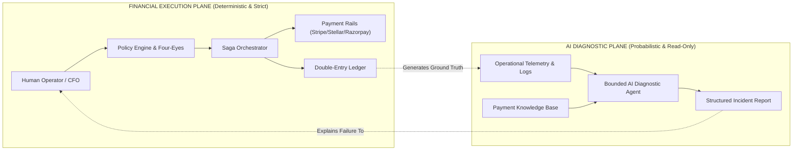
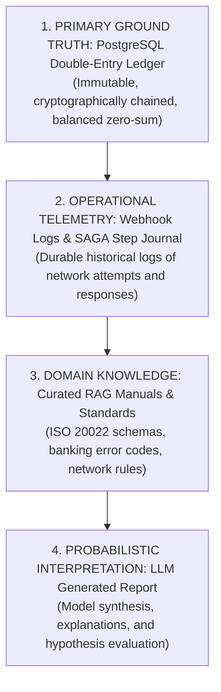

# Project Fusion: Complete Architecture & Interview Learning Guide
**The Definitive Handbook for Fintech Infrastructure Engineers & AI Systems Builders**

---

## Document Metadata & Classification Invariants
- **Target Repository:** `Project-Fusion` (Multi-Rail Payment Orchestration & Bounded AI Diagnostic Copilot)
- **Primary Source of Truth:** Direct codebase inspection of `server.js`, `core/`, `adapters/`, `api/`, `routes/`, `db/`, and `client/`
- **Technical Domains Covered:** Multi-Rail Payment Orchestration, SAGA State Machines, Transactional Outbox, Double-Entry Financial Ledgers, Cryptographic Hash Chains, Hybrid RAG (Lexical BM25 + Dense Semantic), Bounded Tool-Calling AI Agents, and Local OpenTelemetry Observability.
- **Classification Status:**
  - **Core Payment Gateway & Express Routing:** IMPLEMENTED (SOURCE-VERIFIED, RUNTIME-VERIFIED)
  - **SAGA Execution & Outbox Dispatcher:** IMPLEMENTED (SOURCE-VERIFIED, RUNTIME-VERIFIED)
  - **Double-Entry Ledger & SHA-256 Hash Chain:** IMPLEMENTED (SOURCE-VERIFIED, RUNTIME-VERIFIED)
  - **Stripe & RazorpayX Adapters:** TESTNET / SANDBOX INTEGRATION (SOURCE-VERIFIED)
  - **Stellar Horizon Blockchain Adapter:** TESTNET / SANDBOX INTEGRATION (SOURCE-VERIFIED)
  - **Simulated Crypto Rails (BTC / ETH):** MOCKED / SIMULATED
  - **Zoho Books API Integration:** PARTIALLY IMPLEMENTED (Mock & OAuth Stub, SOURCE-VERIFIED)
  - **Account Aggregator (AA) Consent Flow:** MOCKED / SIMULATED
  - **Hybrid RAG (BM25 + Cosine Dense Vector):** IMPLEMENTED (SOURCE-VERIFIED, with deterministic mock embedding fallback when Ollama is offline)
  - **Bounded Agent Loop & Tool Registry (9 Tools):** IMPLEMENTED (SOURCE-VERIFIED, RUNTIME-VERIFIED via synthetic evaluation suites)
  - **Air-Gapped AI Read-Only Enforcement:** IMPLEMENTED (SOURCE-VERIFIED via in-memory synthetic store and read-only DB querying; no write capabilities granted)
  - **Data Loss Prevention (DLP / PII Masking):** IMPLEMENTED (SOURCE-VERIFIED)
  - **Evidence Citation Validator:** IMPLEMENTED (SOURCE-VERIFIED, runtime re-prompting on hallucinated evidence keys)
  - **OpenTelemetry AI Observability:** IMPLEMENTED (SOURCE-VERIFIED, local in-memory trace buffer)

---

# Table of Contents
1. [What is Project Fusion?](#1-what-is-project-fusion)
   - [The Problem Space](#11-the-problem-space)
   - [Target Audience & Personas](#12-target-audience--personas)
   - [The Core Analogy: The International Airport of Money & Air-Crash Investigation](#13-the-core-analogy)
   - [High-Level Architecture Diagram](#14-high-level-architecture-diagram)
   - [Scope Boundaries: What Fusion Is vs. What It Is Not](#15-scope-boundaries)
2. [Part A: Complete Fintech & Payment Architecture](#2-part-a-complete-fintech--payment-architecture)
   - [A1. Fundamental Fintech Concepts from Zero](#a1-fundamental-fintech-concepts-from-zero)
   - [A2. Project Fusion Payment Architecture (17-Step Request Lifecycle)](#a2-project-fusion-payment-architecture-17-step-request-lifecycle)
   - [A3. Provider Adapters & Payment Rails](#a3-provider-adapters--payment-rails)
   - [A4. Payment Lifecycle & Distributed State Machine](#a4-payment-lifecycle--distributed-state-machine)
   - [A5. Distributed Transactions & SAGA Pattern](#a5-distributed-transactions--saga-pattern)
   - [A6. Reliable Event Delivery & The Transactional Outbox](#a6-reliable-event-delivery--the-transactional-outbox)
   - [A7. Financial Ledger, Double-Entry Accounting & Hash Chains](#a7-financial-ledger-double-entry-accounting--hash-chains)
   - [A8. Automated Reconciliation](#a8-automated-reconciliation)
   - [A9. Database Architecture (PostgreSQL Schema & ERD)](#a9-database-architecture-postgresql-schema--erd)
   - [A10. Security, Compliance & Governance Controls](#a10-security-compliance--governance-controls)
3. [Part B: Complete AI Architecture](#3-part-b-complete-ai-architecture)
   - [B1. Fundamental AI & Agentic Concepts from Zero](#b1-fundamental-ai--agentic-concepts-from-zero)
   - [B2. Project Fusion AI Architecture & Execution Lifecycle](#b2-project-fusion-ai-architecture--execution-lifecycle)
   - [B3. Deep-Dive: The Hybrid Retrieval-Augmented Generation (RAG) Pipeline](#b3-deep-dive-the-hybrid-retrieval-augmented-generation-rag-pipeline)
   - [B4. Autonomous Diagnostic Agent & Tool-Calling Registry](#b4-autonomous-diagnostic-agent--tool-calling-registry)
   - [B5. AI Safety, Guardrails, Data Loss Prevention (DLP) & Citation Enforcement](#b5-ai-safety-guardrails-data-loss-prevention-dlp--citation-enforcement)
   - [B6. Evaluation, Benchmarks & OpenTelemetry Observability](#b6-evaluation-benchmarks--opentelemetry-observability)
4. [Part C: Convergence — How Fintech & AI Collaborate](#4-part-c-convergence--how-fintech--ai-collaborate)
   - [The Air-Gap Principle](#c1-the-air-gap-principle)
   - [End-to-End Walkthrough: Autonomous Triage of a Disputed Cross-Border Settlement](#c2-end-to-end-walkthrough-autonomous-triage-of-a-disputed-cross-border-settlement)
   - [Hierarchy of Evidence](#c3-hierarchy-of-evidence)
5. [Part D: Technology Stack & Engineering Decision Records](#5-part-d-technology-stack--engineering-decision-records)
   - [Complete Software Bill of Materials (SBOM)](#d1-complete-software-bill-of-materials-sbom)
   - [Key Architectural Decision Records (ADRs)](#d2-key-architectural-decision-records-adrs)
6. [Part E: Real-World Distributed Systems Failure Scenarios](#6-part-e-real-world-distributed-systems-failure-scenarios)
   - [Catalog of 14 Production Incidents & Recovery Behaviors](#catalog-of-14-production-incidents--recovery-behaviors)
7. [Part F: Technical Interview Mastery & Defence](#7-part-f-technical-interview-mastery--defence)
   - [F1. The Two-Minute Executive Pitch](#f1-the-two-minute-executive-pitch)
   - [F2. 25 In-Depth Fintech Infrastructure Questions & Answers](#f2-25-in-depth-fintech-infrastructure-questions--answers)
   - [F3. 25 In-Depth AI Systems & Agent Questions & Answers](#f3-25-in-depth-ai-systems--agent-questions--answers)
   - [F4. Architecture Defence Questions](#f4-architecture-defence-questions)
   - [F5. How to Draw and Defend Every Architecture Diagram](#f5-how-to-draw-and-defend-every-architecture-diagram)
8. [Part G: Master Technical Glossary](#8-part-g-master-technical-glossary)

---

# 1. What is Project Fusion?

### 1.1 The Problem Space
In global enterprise finance, managing capital flow is plagued by severe technical fragmentation:
1. **Disparate Payment Rails:** Domestic payments in India flow through IMPS/NEFT/UPI via aggregators like Razorpay; European/US corporate cards and wires flow through Stripe; cross-border treasury settlements flow through the Stellar blockchain network or SWIFT pacs.008 XML messages. Each network exposes different APIs, error codes, settlement latencies, and payload schemas.
2. **The Dual-Write & Outbox Failure Problem:** When an enterprise initiates a payment, updating the internal database and notifying the payment network across an unreliable internet connection frequently causes split-brain states—money is deducted, but the payment is lost, or a retry double-debits the account.
3. **The Auditability Crisis:** When cross-border payments fail, finance teams spend days hunting through raw server logs, webhook payloads, and banking portals to answer a simple question: *"Where is the money, why did it stop, and who is responsible?"*

### 1.2 Target Audience & Personas
- **Chief Financial Officers (CFOs) & Corporate Treasurers:** Require real-time visibility into multi-currency liquidity across bank accounts, automated reconciliation with ERPs (Zoho Books), and strict Four-Eyes (Maker-Checker) approval policies.
- **Payment Operations (PayOps) Engineers:** Require an automated orchestration engine that manages retries, idempotency, and smart fallback routing when an upstream bank experiences downtime.
- **Compliance & Fraud Investigators:** Require an immutable, double-entry audit trail that mathematically proves accounts balanced at every microsecond, accompanied by an AI assistant that can instantly diagnose payment anomalies.

### 1.3 The Core Analogy
> **Think of Project Fusion as a High-Security International Airport connected to an Autonomous National Transportation Safety Board (NTSB) Forensic Lab.**
> 
> - **The Passenger (Payment Instruction):** Wants to travel from Country A to Country B with a specific ticket value.
> - **The Airline Gate (API Gateway & Ingestion):** Verifies the passenger's identity, tickets, and baggage (Authentication, KYC, and AML screening).
> - **The Air Traffic Controller (Payment Orchestrator & SAGA):** Decides which runway and airline will fly the passenger—Stripe flight, Razorpay flight, or Stellar flight—based on weather and runway congestion (Smart Routing).
> - **The Flight Logbook (Double-Entry Ledger & Hash Chain):** An immutable, tamper-evident black box where every takeoff and landing is cryptographically signed and chained together. No entry can be erased without breaking the chain.
> - **The NTSB Investigator (AI Investigation Copilot):** If a flight is delayed or crashes (payment failure or webhook timeout), the AI investigator does not fly the planes or open runway gates. Instead, it enters the control tower, reads the radar logs, inspects the weather reports, consults the pilot training manuals (RAG Knowledge Base), and provides the chief controller with an evidence-backed incident report explaining exactly what went wrong.

---

### 1.4 High-Level Architecture Diagram

```mermaid
flowchart TD
    subgraph ClientTier ["User Interface Tier (Next.js 15)"]
        UI["Corporate Treasury Dashboard<br/>(client/src/app/page.tsx)"]
        Modal["Payment Investigation Modal<br/>(client/src/app/components/ai/)"]
        ApproveUI["Maker-Checker Four-Eyes Portal<br/>(client/src/app/approve/)"]
    end

    subgraph GatewayTier ["API & Security Gateway Tier (Express :3000)"]
        AuthMiddleware["authenticateClient (API Key / Session)<br/>(server.js:253)"]
        IdempotencyStore["In-Memory / Redis Idempotency Guard<br/>(server.js:457)"]
        ObservabilityProxy["Next.js Proxy Handler<br/>(client/src/app/api/[...path]/route.ts)"]
    end

    subgraph CoreOrchestrationTier ["Core Orchestration & Workflow Tier"]
        Orchestrator["Saga Core Orchestrator<br/>(core/orchestrator/sagaCore.js)"]
        ApprovalService["Canonical Approval Service<br/>(core/approvals/canonicalApprovalService.js)"]
        OutboxDispatcher["Transactional Outbox Dispatcher<br/>(core/approvals/canonicalApprovalService.js:402)"]
        Reconciler["SAGA Reconciliation Engine<br/>(server.js:1142 & reconciliationService.js)"]
        CashSentinel["CashSentinel Alert Cron<br/>(core/cashiq/cashSentinel.js)"]
    end

    subgraph ProviderAdapterTier ["Multi-Rail Provider Adapters Tier"]
        StripeAd["Stripe Adapter (USD/EUR)<br/>(adapters/paymentsAdapters.js)"]
        RazorpayAd["RazorpayX Adapter (INR)<br/>(adapters/razorpayAdapter.js)"]
        StellarAd["Stellar Horizon (XLM)<br/>(adapters/cryptoAdapters.js)"]
        ZohoAd["Zoho Books Adapter (ERP)<br/>(adapters/zohoAdapter.js)"]
        SimCryptoAd["BTC/ETH Simulators<br/>(core/orchestrator/sagaCore.js:237)"]
    end

    subgraph PersistenceTier ["Persistence & Cryptographic Ledger Tier (PostgreSQL)"]
        InstructionsDB[("instructions Table<br/>(State Machine Record)")]
        LedgerDB[("ledger_journal Table<br/>(Double-Entry SHA-256 Chain)")]
        OutboxDB[("saga_dispatch_outbox Table<br/>(Durable Event Queue)")]
        AuditDB[("auth_audit_log Table<br/>(Immutable Operator Actions)")]
    end

    subgraph AIAgentTier ["AI Diagnostic Copilot Tier (Local-First Agent)"]
        AgentLoop["Bounded Agent Loop (Max 4 Rounds)<br/>(core/ai/orchestrator/agentLoop.js)"]
        ToolReg["Tool Registry (9 Read-Only Tools)<br/>(core/ai/tools/toolRegistry.js)"]
        HybridRAG["Hybrid RAG Engine (BM25 + Dense Vector)<br/>(core/ai/rag/retrieval/hybridRanker.js)"]
        DLPMasker["DLP Context Sanitizer (Luhn & Mod97)<br/>(core/ai/security/dlpMasker.js)"]
        CitationVal["Evidence Citation Validator<br/>(core/ai/validators/evidenceCitationValidator.js)"]
        LocalLLM["Ollama / Local Mock Model Provider<br/>(core/ai/providers/ollamaProvider.js)"]
        TelemetrySvc["OpenTelemetry AI Telemetry Service<br/>(core/ai/observability/telemetryService.js)"]
    end

    %% Client Interactions
    UI -->|Polls Health & Liquidity| ObservabilityProxy
    Modal -->|SSE Stream /api/ai/agent-investigate/stream| ObservabilityProxy
    ApproveUI -->|POST /api/approvals/approve| ObservabilityProxy
    ObservabilityProxy --> AuthMiddleware

    %% Gateway to Orchestrator
    AuthMiddleware --> IdempotencyStore
    IdempotencyStore --> Orchestrator
    ApproveUI --> ApprovalService
    ApprovalService --> OutboxDB
    OutboxDispatcher --> OutboxDB
    OutboxDispatcher --> Orchestrator

    %% Orchestrator to Database & Adapters
    Orchestrator --> InstructionsDB
    Orchestrator --> LedgerDB
    Orchestrator --> StripeAd
    Orchestrator --> RazorpayAd
    Orchestrator --> StellarAd
    Orchestrator --> ZohoAd
    Orchestrator --> SimCryptoAd

    %% Background Engines
    Reconciler --> InstructionsDB
    Reconciler --> LedgerDB
    CashSentinel --> InstructionsDB

    %% AI Diagnostics Workflow
    ObservabilityProxy -->|AI Diagnostic Query| DLPMasker
    DLPMasker --> AgentLoop
    AgentLoop --> LocalLLM
    AgentLoop --> ToolReg
    ToolReg -->|Read-Only Evidence| InstructionsDB
    ToolReg -->|Read-Only Evidence| LedgerDB
    ToolReg -->|Domain Docs| HybridRAG
    AgentLoop --> CitationVal
    AgentLoop --> TelemetrySvc
```



---

### 1.5 Scope Boundaries: What Fusion Is vs. What It Is Not

| Capability Domain | What Project Fusion Is | What Project Fusion Is NOT |
| :--- | :--- | :--- |
| **Financial Engine** | A multi-rail orchestration engine with real testnet integrations (Stripe Testnet, RazorpayX Testnet, Stellar Testnet) and simulated digital asset rails. | Not a chartered commercial bank, licensed Payment System Operator (PSO), or custodian of real-world fiat currency. |
| **Accounting** | An internal double-entry cryptographic ledger that tracks obligations, asset balances, and micro-unit decimal precision. | Not a certified general-ledger ERP system (it synchronizes with external ERPs like Zoho Books). |
| **AI Investigation** | A strictly read-only, bounded diagnostic copilot that inspects forensic telemetry and payment evidence to explain failures to operators. | Not an autonomous payment bot. The AI has zero privileges to initiate transactions, approve payments, execute SQL, or mutate states. |
| **Infrastructure** | A dual-tier Node.js/TypeScript architecture (Next.js 15 frontend + Express backend) backed by PostgreSQL 17. | Not a globally distributed microservices cluster (designed for localized enterprise demonstration and deterministic review). |

---

# 2. Part A: Complete Fintech & Payment Architecture

## A1. Fundamental Fintech Concepts from Zero

To excel in a fintech engineering interview, you must command both the business vocabulary and the exact database/network mechanisms behind every transaction.

### 1. What is a Payment?
A legal and financial transfer of monetary value from a debtor (payer) to a creditor (payee) that extinguishes an underlying obligation.

### 2. What is a Payment Instruction?
A digital message transmitted by an account holder instructing a financial institution or gateway to execute a transfer of funds.  
*In Project Fusion:* Represented by a record in the `instructions` table with a unique UUID (`instruction_id`), specifying `sender`, `recipient`, `amount`, `currency`, and `state`.

### 3. What is a Payment Rail?
The physical, telecommunication, and legal clearing infrastructure that actually transports money between financial entities. Examples:
- **India:** UPI (Unified Payments Interface - instant retail), NEFT (National Electronic Funds Transfer - batched), IMPS (Immediate Payment Service - 24/7 instant), RTGS (Real-Time Gross Settlement - high value).
- **United States:** Fedwire (instant RTGS), ACH (Automated Clearing House - 1 to 3 day batched clearing), RTP (Real-Time Payments).
- **Europe:** SEPA Credit Transfer, TARGET2.
- **Blockchain:** Stellar Network (decentralized consensus for asset-backed tokens).

### 4. What is a Payment Service Provider (PSP)?
A third-party intermediary that aggregates multiple payment rails, providing merchants with a unified API, fraud tools, and acquiring capabilities. Examples: Stripe, Razorpay, Adyen, Checkout.com.

### 5. What is Payment Orchestration?
An intelligent software layer that sits *above* individual PSPs and payment rails. Instead of hardcoding Stripe into your checkout, an orchestration engine dynamically decides whether a transaction should be routed to Stripe, Razorpay, or Stellar based on fees, success rates, currency, and geographic compliance rules.

### 6. What is a Provider Adapter?
A software design pattern (Structural Adapter) that translates between the internal unified data model of your application and the proprietary, vendor-specific API formats of external PSPs.

### 7. What is Payment Routing?
The algorithmic logic used to select the optimal payment rail for a transaction. In Fusion:
- If `currency === 'INR'` $\rightarrow$ RazorpayX Rail.
- If `currency === 'USD' || 'EUR' || 'GBP'` $\rightarrow$ Stripe Rail.
- If `currency === 'XLM'` $\rightarrow$ Stellar Horizon Testnet Rail.
- If `currency === 'BTC' || 'ETH'` $\rightarrow$ Simulated Internal Crypto Rail.

### 8. The Payment Lifecycle: Authorization vs. Capture vs. Settlement
- **Authorization:** The issuing bank reserves funds on the payer's account and verifies fraud/limits, but no money has moved.
- **Capture:** The merchant confirms that goods/services will be delivered, requesting that the reserved funds be claimed.
- **Clearing:** The exchange of payment information between the acquiring bank and issuing bank.
- **Settlement:** The actual physical movement of funds between bank accounts across an interbank clearinghouse.
- **Reconciliation:** The accounting process of comparing internal database records against the bank's external settlement statement to verify that every rupee or dollar was accounted for.

### 9. What is a Financial Ledger & Double-Entry Bookkeeping?
An immutable log of financial transactions. In double-entry bookkeeping, **every transaction must balance**:
$$\sum \text{Debits} = \sum \text{Credits}$$
Money never appears or disappears from thin air; it is transferred from an account that is debited to an account that is credited.

### 10. What is Idempotency?
The mathematical property ($f(f(x)) = f(x)$) where an operation can be applied multiple times without changing the result beyond the initial application. In payments, if a network timeout occurs and a client resends a `POST /transfer` with the same `x-idempotency-key`, the system **must not charge the user twice**; it must return the original cached response.

---

## A2. Project Fusion Payment Architecture (17-Step Request Lifecycle)

The following lifecycle traces a payment request from a button click on the Next.js corporate dashboard through to final settlement and ledger chaining.



### Detailed Trace of Key Source Functions

| Step | Source File | Function / Endpoint | Purpose & Technical Operation |
| :--- | :--- | :--- | :--- |
| **1-3** | [`server.js`](server.js#L253-L274) | `authenticateClient` & `checkIdempotency` | Validates `x-api-key` header against `process.env.API_SECRET_KEY`. Checks memory/Redis idempotency cache to abort duplicate requests with HTTP 409. |
| **4-5** | [`core/approvals/canonicalApprovalService.js`](core/approvals/canonicalApprovalService.js#L63) | `evaluateApprovalPolicy` | Evaluates Four-Eyes rules: transactions above threshold (e.g. > ₹50,000) transition to `PENDING_APPROVAL` requiring second-operator WebAuthn biometric confirmation. |
| **6-8** | [`core/approvals/canonicalApprovalService.js`](core/approvals/canonicalApprovalService.js#L350) | `enqueueDispatchOutbox` | Atomically writes the approved instruction and its dispatch task to `identity.saga_dispatch_outbox` inside the same database transaction. |
| **9-12**| [`core/orchestrator/sagaCore.js`](core/orchestrator/sagaCore.js#L77) | `processInstructionSagaAtomic` | Acquires row lock (`FOR UPDATE`), verifies balance liquidity, sets state to `LOCKED`, resolves provider adapter, and updates state to `PENDING_EXECUTION`. |
| **13-15**| [`core/orchestrator/sagaCore.js`](core/orchestrator/sagaCore.js#L166) | `executeInstructionInternal` | Calls the resolved provider adapter (`paymentsAdapters.js`, `razorpayAdapter.js`, or `cryptoAdapters.js`). |
| **16-17**| [`core/orchestrator/ledgerUtils.js`](core/orchestrator/ledgerUtils.js#L8) | `writeLedger` | Acquires transaction-level lock (`pg_advisory_xact_lock(998877)`), reads previous chain head, computes SHA-256 hashes, inserts double-entry rows, and marks instruction `SETTLED`. |

---

## A3. Provider Adapters & Payment Rails

Project Fusion abstracts external providers using structural adapter modules located in `/adapters`.



### Deep-Dive: Specific Adapter Implementations

#### 1. Stripe Adapter ([`adapters/paymentsAdapters.js`](adapters/paymentsAdapters.js))
- **Rails Supported:** Visa, Mastercard, American Express, SEPA Direct Debit (USD, EUR, GBP, CAD).
- **Authentication:** HTTP Bearer token using restricted testnet keys (`sk_test_*` or `rk_test_*`). Live keys (`sk_live_*`) are blocked fail-closed by [`core/configValidator.js:65`](core/configValidator.js#L65).
- **Amount Scaling:** Converts floating decimal amounts into minor currency units (cents/pence) using canonical BigInt scaling:
  $$\text{minorUnits} = \text{BigInt}(\text{amount} \times 10^{\text{scale}})$$
- **Testnet Status:** Fully connected to Stripe Testnet API.

#### 2. RazorpayX Corporate Payouts Adapter ([`adapters/razorpayAdapter.js`](adapters/razorpayAdapter.js))
- **Rails Supported:** India Domestic Rails (IMPS, NEFT, RTGS, UPI) in INR.
- **Authentication:** HTTP Basic Authentication using `RAZORPAY_KEY_ID` (`rzp_test_*`) and `RAZORPAY_KEY_SECRET`.
- **Composite Payout Pipeline:** First creates or resolves a vendor `contact_id`, attaches a `fund_account_id` (Bank Account + IFSC code), and dispatches a payout instruction returning a payout ID (`pout_*`).
- **Testnet Status:** Fully connected to RazorpayX Sandbox.

#### 3. Stellar Horizon Blockchain Adapter ([`adapters/cryptoAdapters.js`](adapters/cryptoAdapters.js))
- **Rails Supported:** Stellar Consensus Protocol (SCP) decentralized ledger (Asset: `XLM`, Native Lumens).
- **Authentication:** Cryptographic Ed25519 public/private key pairs. Transactions are serialized to XDR (External Data Representation) and signed using the secret key seed.
- **Testnet Endpoint:** Official Stellar Development Foundation Horizon Testnet (`https://horizon-testnet.stellar.org`) with network passphrase:  
  `Test SDF Network ; September 2015`.
- **Testnet Status:** Fully functional testnet integration with live Horizon RPC queries.

---

## A4. Payment Lifecycle & Distributed State Machine

Project Fusion implements a strict, deterministic state machine on the `instructions.state` column, reinforced by database triggers ([`identity.trg_enforce_instructions_state_guard`](server.js#L160)).



### Permitted vs. Prohibited State Transitions

| Starting State | Permitted Destination States | Triggering Event / Code Function | Prohibited Transitions (Enforced by Trigger) |
| :--- | :--- | :--- | :--- |
| `INITIATED` | `PENDING_APPROVAL`, `LOCKED`, `FAILED` | Policy evaluation (`canonicalApprovalService.js:63`) | Cannot skip directly to `SETTLED` or `EXECUTED`. |
| `PENDING_APPROVAL` | `APPROVED`, `VOIDED` | Maker-checker approval signature ([`server.js:690`](server.js#L690)) | Cannot transition to `LOCKED` without operator authorization. |
| `LOCKED` | `PENDING_EXECUTION`, `MANUAL_CHECK` | Liquidity reservation in [`sagaCore.js:138`](core/orchestrator/sagaCore.js#L138) | Cannot be altered by standard application runtime without definer context. |
| `PENDING_EXECUTION` | `SETTLED`, `PENDING_SETTLEMENT`, `FAILED`, `MANUAL_CHECK` | Adapter execution response in [`sagaCore.js:318`](core/orchestrator/sagaCore.js#L318) | Cannot revert to `INITIATED` or `PENDING_APPROVAL`. |
| `SETTLED` | *None (Terminal State)* | Immutable. Double-entry ledger posted. | **Strictly Prohibited:** Any update to amount, recipient, or state throws database exception. |
| `VOIDED` | *None (Terminal State)* | Instruction permanently cancelled. | Cannot be un-voided or executed under any role. |

---

## A5. Distributed Transactions & SAGA Pattern

### Why Normal Database Transactions Fail in Payments
In a monolithic database, you can wrap operations in `BEGIN ... COMMIT`. If anything fails, the entire transaction rolls back cleanly.  
However, when moving money across banking rails:
1. You debit an internal customer balance in PostgreSQL.
2. You call Stripe or Razorpay over HTTP.
3. The bank charges the money, but your network connection drops before receiving the response.

**You cannot "roll back" an HTTP call.** The bank has already debited the funds. You cannot hold an open database lock while waiting for a 15-second banking API timeout.

### How Project Fusion Implements SAGA
Project Fusion uses an **Orchestration-based SAGA** ([`core/orchestrator/sagaCore.js`](core/orchestrator/sagaCore.js)):
- **Forward Steps:**
  1. *Step 1 (Liquidity Check & Lock):* Verify account balance $\ge$ amount; mark instruction `LOCKED`.
  2. *Step 2 (Provider Dispatch):* Execute HTTP call to external PSP adapter; mark instruction `PENDING_EXECUTION`.
  3. *Step 3 (Settlement Posting):* Upon provider confirmation, write atomic double-entry ledger entries and mark instruction `SETTLED`.
- **Compensating Actions:**
  If Step 2 suffers an unrecoverable failure (e.g. invalid account, card stolen), the orchestrator executes a compensation step:
  - Unlocks reserved balances.
  - Updates instruction state to `FAILED`.
  - Records an error event in `reconciliation_log`.
- **Timeout / Indeterminate States:**
  If Step 2 times out, the SAGA does **not** assume failure (to avoid double charging). It marks the instruction as `MANUAL_CHECK` or `PENDING_SETTLEMENT` and delegates resolution to the asynchronous Reconciler ([`server.js:1142`](server.js#L1142)).

---

## A6. Reliable Event Delivery & The Transactional Outbox

### The Dual-Write Problem
When an operator approves a payment, the application must:
1. Update `instructions` state to `APPROVED` in PostgreSQL.
2. Publish an execution event to the queue or trigger the SAGA orchestrator.

If the server crashes after step 1, the payment is approved in the database but never executed. If step 2 runs first and step 1 fails, money is moved without a database record.

### The Outbox Solution in Project Fusion
Fusion solves this using the **Transactional Outbox Pattern** ([`core/approvals/canonicalApprovalService.js:350-474`](core/approvals/canonicalApprovalService.js#L350)):

```sql
-- Both operations execute in the exact same ACID database transaction:
BEGIN;
UPDATE instructions SET approval_status = 'APPROVED' WHERE instruction_id = $1;
INSERT INTO identity.saga_dispatch_outbox (
    dispatch_id, instruction_id, status, attempts, max_attempts, scheduled_for
) VALUES (gen_random_uuid(), $1, 'PENDING', 0, 5, NOW());
COMMIT;
```

#### The Outbox Dispatcher Worker (`drainDispatchOutbox`)
- An asynchronous background worker runs periodically ([`server.js:1359`](server.js#L1359), every 15 seconds) and on application startup.
- It queries the outbox using high-concurrency row locking:
  ```sql
  SELECT * FROM identity.saga_dispatch_outbox
  WHERE (status = 'PENDING' OR (status = 'PROCESSING' AND dispatched_at < NOW() - INTERVAL '5 minutes'))
    AND attempts < max_attempts
    AND scheduled_for <= NOW()
  ORDER BY created_at ASC
  LIMIT 10
  FOR UPDATE SKIP LOCKED;
  ```
- **`FOR UPDATE SKIP LOCKED`** allows multiple worker threads to process outbox events concurrently without deadlocking or blocking each other.
- Upon successful execution by `processInstructionSagaAtomic`, the outbox record is marked `COMPLETED`. If it fails, `attempts` increments with exponential backoff.

---

## A7. Financial Ledger, Double-Entry Accounting & Hash Chains

### Fundamental Accounting Equations
In Project Fusion, all financial movements obey the fundamental accounting identity:
$$\text{Assets} = \text{Liabilities} + \text{Equity}$$
- **DEBIT:** An entry that increases an Asset account or decreases a Liability/Equity account.
- **CREDIT:** An entry that decreases an Asset account or increases a Liability/Equity account.

### Illustrative Real-World Example
**Scenario:** Alice Corp pays Bob Supply ₹10,000 for server infrastructure.
- **Assumed Account Model:**
  - `Alice_Corp` (Client Asset Account)
  - `Bob_Supply` (Client Asset Account)
  - `FUSION_MASTER` (Platform Clearing Account)

```
Transaction 1 (Debit Sender):
Account: Alice_Corp | Direction: DEBIT  | Amount: ₹10,000.00 (Alice's balance reduces)
Account: FUSION_MASTER | Direction: CREDIT | Amount: ₹10,000.00 (Clearing holds funds)

Transaction 2 (Credit Payee):
Account: FUSION_MASTER | Direction: DEBIT  | Amount: ₹10,000.00 (Clearing releases funds)
Account: Bob_Supply   | Direction: CREDIT | Amount: ₹10,000.00 (Bob's balance increases)
```
$$\text{Net Clearing Balance} = 0 \quad (\text{Balanced Zero-Sum})$$

---

### The Project Fusion Ledger Implementation (`ledger_journal`)

The table `ledger_journal` records every financial event with micro-unit precision:

```sql
CREATE TABLE IF NOT EXISTS ledger_journal (
  entry_id UUID PRIMARY KEY DEFAULT gen_random_uuid(),
  instruction_id UUID NOT NULL,
  account_id VARCHAR(50) NOT NULL,
  direction VARCHAR(10) CHECK (direction IN ('DEBIT', 'CREDIT')),
  amount NUMERIC(56, 18) NOT NULL,
  currency VARCHAR(10) NOT NULL,
  timestamp TIMESTAMPTZ DEFAULT NOW(),
  hash VARCHAR(64),
  prev_hash VARCHAR(64),
  sequence_id BIGSERIAL UNIQUE
);
```

#### Exact Canonical SHA-256 Hash Preimage
Inspected from [`core/orchestrator/ledgerUtils.js:26-36`](core/orchestrator/ledgerUtils.js#L26) and [`scripts/verify_integrity.js:29`](scripts/verify_integrity.js#L29):

$$\text{Payload} = \text{prev\_hash} \parallel \text{entry\_id} \parallel \text{instruction\_id} \parallel \text{account\_id} \parallel \text{direction} \parallel \text{amt} \parallel \text{currency} \parallel \text{ts}$$
$$\text{entry\_hash} = \text{SHA256}(\text{Payload})$$

```javascript
// Byte-for-byte serialization format in core/orchestrator/ledgerUtils.js:
const amt = toCanonicalDecimal(entry.amount, entry.currency);
const canonicalPayload = `${prevHash}${entryId}${instructionId}${accountId}${direction}${amt}${currency}${timestamp}`;
const hash = crypto.createHash('sha256').update(canonicalPayload).digest('hex');
```

- **`entry_id` Inclusion:** **CONFIRMED.** The primary key UUID `entry_id` is an integral component of the hash payload.
- **Zero Delimiters:** Fields are concatenated directly with no colons, spaces, or pipes.
- **Timestamp Normalization:** Strict ISO 8601 UTC representation ending in `'Z'` (e.g. `'2026-11-11T12:00:00.000Z'`).
- **Exact Decimal Scaling (`financialDecimal.js`):** Amount is converted using `toCanonicalDecimal()` which prevents floating-point rounding errors (e.g. `0.1 + 0.2 === 0.30000000000000004` is eliminated).
  - USD, EUR, GBP, INR: 2 decimal places (`'1000.50'`)
  - KWD, BHD: 3 decimal places (`'500.125'`)
  - JPY, KRW: 0 decimal places (`'150000'`)
  - XLM: 7 decimal places (`'100.1234567'`)

#### What the Hash Chain Proves vs. What It Does Not Prove
- **What It Proves:** It provides **tamper-evidence**. If an attacker with direct database access alters an account name or amount in row 42, the hash of row 42 changes, which invalidates the `prev_hash` of row 43, causing every subsequent link in the chain to break.
- **What It Does Not Prove:** It is **not tamper-proof**. An attacker with database admin privileges could recalculate the entire hash chain from row 42 to the head. To become tamper-proof, the chain head must be periodically anchored to an external trust root (e.g. RFC 3161 timestamping authority or a public blockchain).

---

## A8. Automated Reconciliation

### The Discrepancy Problem
A payment gateway may report that a charge succeeded, but due to an internet partition, your webhook handler failed to execute. Conversely, your database may believe a transaction is pending, while the bank rejected it for compliance reasons.

### The Fusion Reconciliation Loop ([`server.js:1142-1228`](server.js#L1142))
1. **Accelerated Polling Reconciler:** Runs every 8 seconds in testnet mode.
2. **Detection Query:** Scans `instructions` for rows where `state IN ('INITIATED', 'PENDING', 'PENDING_EXECUTION', 'PENDING_SETTLEMENT')` and `created_at < NOW() - INTERVAL '10 seconds'`.
3. **Provider Status Query:** Calls `adapter.queryStatus(intentId)` to fetch authoritative truth from Stripe, Razorpay, or Stellar.
4. **Automated Recovery:**
   - If provider reports `succeeded` or `processed`: Reconciler transitions state to `SETTLED`, writes the double-entry ledger rows via `writeLedger()`, and calls `reconcileToZoho()` to clear the ERP invoice.
   - If provider reports `failed` or `canceled`: Transitions state to `FAILED`.
   - All outcomes are appended to `reconciliation_log` for regulatory auditability.

---

## A9. Database Architecture (PostgreSQL Schema & ERD)



---

## A10. Security, Compliance & Governance Controls

| Governance Control | Code Implementation | Status | Description |
| :--- | :--- | :--- | :--- |
| **API Authentication** | [`server.js:253`](server.js#L253) (`authenticateClient`) | **IMPLEMENTED** | Validates `x-api-key` header against server secret; protects institutional endpoints. |
| **Idempotency Guard** | [`server.js:457`](server.js#L457) (`checkIdempotency`) | **IMPLEMENTED** | Evaluates `x-idempotency-key` with memory fallback; rejects concurrent duplicates with HTTP 409. |
| **Strict Testnet Enforcement** | [`core/configValidator.js`](core/configValidator.js#L64) | **IMPLEMENTED** | Fails closed on startup if live API keys (`sk_live_*`, `rzp_live_*`) are detected. |
| **Four-Eyes Maker-Checker** | [`server.js:690`](server.js#L690) (`CanonicalApprovalService`) | **IMPLEMENTED** | High-value payments require dual cryptographic operator authorization before dispatch. |
| **State Guard Triggers** | `identity.trg_enforce_instructions_state_guard` | **IMPLEMENTED** | Database engine blocks direct SQL updates to `SETTLED` or `VOIDED` outside definer context. |
| **AML Sanctions Screening** | [`core/complianceInterceptor.js:9`](core/complianceInterceptor.js#L9) (`checkAML`) | **IMPLEMENTED** | Validates sender and recipient against `sanctions_list` table before execution. |
| **Mutual TLS (mTLS)** | [`server.js:23`](server.js#L23) & [`client/src/app/api/[...path]/route.ts`](client/src/app/api/[...path]/route.ts#L81) | **PARTIALLY IMPLEMENTED** | Enforced when `LOCAL_ONLY=false` using client/server certificates in `/certs`. Bypassed in local development. |
| **HSM Simulation** | [`vaultProvider.js`](vaultProvider.js) | **MOCKED / SIMULATED** | Simulates Hardware Security Module key isolation using local encrypted Vault stubs. |

---

# 3. Part B: Complete AI Architecture

## B1. Fundamental AI & Agentic Concepts from Zero

### 1. What is an LLM (Large Language Model)?
A deep neural network (transformer architecture) trained on massive text datasets to predict the most statistically probable next token given an input sequence.

### 2. Tokens & Context Windows
- **Token:** The fundamental unit of text processed by an LLM (roughly 4 characters or 0.75 English words).
- **Context Window:** The maximum number of tokens an LLM can accept in a single prompt (e.g. 8,192 tokens for Llama 3.1). Any information outside this window cannot be seen by the model.

### 3. Embeddings & Vectors
- **Vector:** An ordered list of floating-point numbers (e.g. $[0.12, -0.84, 0.45, \dots]$) representing coordinates in high-dimensional geometric space.
- **Embedding:** A mathematical projection where text strings with similar semantic meaning are mapped to nearby coordinates in vector space.

### 4. Semantic Search vs. Lexical Search
- **Lexical Search (BM25):** Searches for exact keyword matches, counting term frequency and inverse document frequency. Great for error codes (`E0401`, `tx_insufficient_fee`), but fails on synonyms.
- **Semantic Search (Vector Embeddings):** Searches for conceptual meaning. Matches "insufficient balance" with "not enough funds", even though they share zero words.
- **Hybrid Search (Fusion AI):** Combines BM25 and Vector search to capture both exact error codes and broad conceptual intent.

### 5. What is Tool Calling (Function Calling)?
A mechanism where an LLM is provided with structured JSON schemas describing external functions (tools). If the model determines it needs external data to answer a user's question, it does not invent an answer; it outputs a structured JSON request:
```json
{
  "name": "get_provider_failure_details",
  "arguments": { "case_id": "CASE-RAZORPAY-PAYOUT-REJECTED" }
}
```
The application executes the function and feeds the real data back to the model.

### 6. Chatbot vs. Autonomous AI Agent
- **LLM Chatbot:** Single-turn request and response. The user asks a question; the model answers immediately from its frozen training weights.
- **AI Agent:** A bounded, iterative loop where the model reasons, selects a tool, inspects the result, determines whether more evidence is needed, calls another tool, and finally synthesizes an answer once sufficient ground truth is collected.

---

## B2. Project Fusion AI Architecture & Execution Lifecycle

The Fusion AI system is a **Local-First, Diagnostic Copilot** designed to investigate anomalous payments, payment failures, and reconciliation discrepancies.

```mermaid
sequenceDiagram
    autonumber
    participant OP as Operator (Dashboard Modal)
    participant API as AI Router (/api/ai/agent-investigate/stream)
    participant DLP as DLP Sanitizer (dlpMasker.js)
    participant LOOP as Bounded Agent Loop (agentLoop.js)
    participant LLM as Model Provider (Ollama / Llama 3.1)
    participant REG as Tool Registry (toolRegistry.js)
    participant DB as PostgreSQL (instructions / ledger)
    participant RAG as Hybrid RAG Engine (hybridRanker.js)
    participant VAL as Evidence Citation Validator

    OP->>API: 1. POST /api/ai/agent-investigate/stream (caseId, question)
    API->>DLP: 2. Sanitize request question (Luhn PAN & IBAN masking)
    DLP-->>API: 3. Masked Prompt & Request-Scoped Token Map
    API-->>OP: 4. SSE Event: { stage: 'INTENT_CLASSIFICATION' }

    API->>LOOP: 5. Initialize AgentLoop (maxRounds: 4, maxTools: 6)
    
    loop Round 1 to Max 4
        LOOP->>LLM: 6. Prompt + Available Tool JSON Schemas
        LLM-->>LOOP: 7. Structured Decision: ToolCall (e.g. get_provider_failure_details)
        LOOP-->>OP: 8. SSE Event: { stage: 'TOOL_EXECUTION', tool: 'get_provider_failure_details' }
        LOOP->>REG: 9. Execute Tool (caseId)
        alt Database Tool
            REG->>DB: 10a. SELECT * FROM instructions WHERE ...
            DB-->>REG: 11a. Operational Evidence Record
        else Knowledge Tool (search_payment_knowledge)
            REG->>RAG: 10b. Hybrid Query (BM25 + Cosine Dense Vector)
            RAG-->>REG: 11b. Top-K Knowledge Chunks & Citations
        end
        REG-->>LOOP: 12. Structured Evidence Object
    end

    LOOP->>LLM: 13. Synthesize Final Incident Report (System Rules: JSON Schema)
    LLM-->>LOOP: 14. Candidate Report JSON
    LOOP->>VAL: 15. Validate Citations against Retrieved Evidence Keys
    VAL-->>LOOP: 16. Citation Audit Passed (Zero Hallucinated Keys)
    LOOP->>DLP: 17. Verify Zero PII Leakage in Generated Synthesis
    LOOP-->>API: 18. Verified Final Report
    API-->>OP: 19. SSE Event: { stage: 'COMPLETE', report: { ... } }
```

---

## B3. Deep-Dive: The Hybrid Retrieval-Augmented Generation (RAG) Pipeline

Project Fusion implements a fully functional **Hybrid RAG Pipeline** located in `core/ai/rag/`.

### 1. The Knowledge Corpus (`core/ai/rag/knowledgeBase/`)
Curated markdown documents organized by domain:
- `/iso20022`: ISO 20022 message structure, PACS.008 credit transfers, and structured address syntax rules.
- `/project-fusion`: Internal double-entry ledger architecture, state transitions, and SAGA outbox patterns.
- `/razorpay`: RazorpayX payout error codes (`BAD_REQUEST_ERROR`, `ACCOUNT_FROZEN`).
- `/stellar`: Stellar Horizon RPC codes (`tx_insufficient_balance`, `tx_bad_seq`).
- `/stripe`: Stripe error codes (`card_declined`, `insufficient_funds`, `expired_card`).

### 2. Ingestion & Document Chunking (`core/ai/rag/ingestion/`)
- **Document Loader ([`documentLoader.js`](core/ai/rag/ingestion/documentLoader.js)):** Traverses markdown files, extracts YAML frontmatter metadata (provider, error codes, doc type).
- **Text Chunker ([`textChunker.js`](core/ai/rag/ingestion/textChunker.js)):** Splits documents using **Header-Aware Markdown Chunking** with a target chunk size of 300 tokens and 50-token overlap. Each chunk retains its breadcrumb hierarchy:  
  `Stripe > Refunds > Handling Webhook Failures`.

### 3. Lexical Retrieval: Okapi BM25 ([`bm25Retriever.js`](core/ai/rag/retrieval/bm25Retriever.js))
Calculates term frequency-inverse document frequency with length normalization:
$$\text{Score}_{\text{BM25}}(D, Q) = \sum_{q \in Q} \text{IDF}(q) \cdot \frac{f(q, D) \cdot (k_1 + 1)}{f(q, D) + k_1 \cdot \left(1 - b + b \cdot \frac{|D|}{\text{avgdl}}\right)}$$
Parameters: $k_1 = 1.2$, $b = 0.75$.

### 4. Dense Semantic Retrieval & Embeddings ([`embeddingProvider.js`](core/ai/rag/retrieval/embeddingProvider.js) & [`denseRetriever.js`](core/ai/rag/retrieval/denseRetriever.js))
- **Embeddings:** Generates 384-dimensional unit vectors using local Ollama models (`nomic-embed-text` or `all-minilm`). When the local Ollama daemon is offline or unconfigured, the system automatically falls back to deterministic mock embedding vectors generated via word-frequency hashing to preserve testability and prevent crash cascades.
- **Classification:** **IMPLEMENTED (SOURCE-VERIFIED)** with graceful mock fallback.
- **Similarity Metric:** Normalizes vectors to unit length ($L_2$ norm) and calculates **Cosine Similarity**:
  $$\text{CosineSimilarity}(\vec{A}, \vec{B}) = \vec{A} \cdot \vec{B} = \sum_{i=1}^{n} A_i B_i$$

### 5. Hybrid Fusion & Ranking ([`hybridRanker.js`](core/ai/rag/retrieval/hybridRanker.js))
Combines lexical and semantic scores using Min-Max Normalization:
$$\text{HybridScore} = \alpha \cdot \text{NormalizedBM25} + (1 - \alpha) \cdot \text{NormalizedDense}$$
Default weight: $\alpha = 0.5$. Chunks scoring below `minRelevanceThreshold = 0.15` are filtered out.

---

## B4. Autonomous Diagnostic Agent & Tool-Calling Registry

The AI Agent accesses operational ground truth exclusively through the **Tool Registry** ([`core/ai/tools/toolRegistry.js`](core/ai/tools/toolRegistry.js)).

### Comprehensive Tool Inventory

| Tool Name | Operational Purpose | Inputs | Output Payload | Underlying Data Source | Read-Only Invariant |
| :--- | :--- | :--- | :--- | :--- | :--- |
| `get_case_overview` | Fetches high-level incident summary, customer name, transaction amount, and reported failure. | `case_id` (string) | JSON: `{ amount, currency, status, initial_error }` | In-memory synthetic store or `instructions` table | **STRICTLY READ-ONLY** |
| `get_transaction_timeline` | Reconstructs step-by-step audit chronology from ingestion to failure. | `case_id` (string) | Array: `[{ timestamp, event, state, actor }]` | `auth_audit_log` & `instructions` | **STRICTLY READ-ONLY** |
| `get_provider_failure_details` | Retrieves raw provider error payloads, HTTP status codes, and network error strings. | `case_id` (string) | JSON: `{ provider, error_code, raw_response }` | External adapter error logs | **STRICTLY READ-ONLY** |
| `get_saga_execution_evidence` | Inspects SAGA orchestrator steps to identify which forward step failed. | `case_id` (string) | JSON: `{ saga_id, failed_step, compensation_status }` | `invoice_saga_steps` table | **STRICTLY READ-ONLY** |
| `get_webhook_delivery_evidence` | Analyzes webhook delivery timestamps, retry counts, and payload HMAC signatures. | `case_id` (string) | JSON: `{ event_type, delivered, signature_valid }` | `processed_webhook_events` table | **STRICTLY READ-ONLY** |
| `get_ledger_integrity_evidence` | Verifies cryptographic hash continuity and asserts double-entry balance. | `case_id` (string) | JSON: `{ chain_intact: bool, balance_offset: 0 }` | `ledger_journal` table | **STRICTLY READ-ONLY** |
| `get_reconciliation_evidence` | Compares internal transaction states against external ERP (Zoho) records. | `case_id` (string) | JSON: `{ internal_state, zoho_state, match: bool }` | `reconciliation_log` table | **STRICTLY READ-ONLY** |
| `explain_iso_validation_errors` | Parses ISO 20022 XML parsing errors (e.g. PACS.008 schema validation). | `case_id` (string) | JSON: `{ xml_tag, rule_violation, line_number }` | ISO validator engine | **STRICTLY READ-ONLY** |
| `search_payment_knowledge` | Executes hybrid RAG query against domain knowledge base. | `query`, `provider` | Array: `[{ chunk_id, title, text, score }]` | Hybrid RAG Engine (`knowledgeBase/`) | **STRICTLY READ-ONLY** |

---

## B5. AI Safety, Guardrails, Data Loss Prevention (DLP) & Citation Enforcement

### 1. The DLP Sanitizer ([`core/ai/security/dlpMasker.js`](core/ai/security/dlpMasker.js))
Before text enters an LLM prompt, it passes through request-scoped regex and algorithmic maskers:
- **Card Numbers (PAN):** Detected via regex and verified using the **Luhn Checksum Algorithm**. Valid cards are replaced with `[MASKED_CARD_01]`.
- **Bank Account / IBAN:** Verified using **ISO 7064 Mod 97-10** check. Replaced with `[MASKED_IBAN_01]`.
- **Indian National Identifiers:** Aadhaar numbers (Verhoeff checksum validated) and PAN cards (regex `[A-Z]{5}[0-9]{4}[A-Z]{1}`) masked.
- **Preservation Guards:** UUIDs, ISO timestamps, financial amounts (`₹10,000`), currency codes (`INR`), and error codes (`tx_insufficient_fee`) are strictly preserved.

### 2. Evidence Citation Validator ([`core/ai/validators/evidenceCitationValidator.js`](core/ai/validators/evidenceCitationValidator.js))
To prevent LLM hallucination:
- Every recommendation and finding generated by the model must cite a valid `evidence_key` (e.g. `get_provider_failure_details.error_code`).
- The validator cross-references every cited key against the actual tools executed during the agent loop.
- If the model cites a non-existent key or invents an error code, the report is **rejected with an automated retry**.

### 3. Structural Security Invariants
- **No SQL Execution:** The AI has no database client or SQL execution interface. It queries data exclusively via pre-compiled JavaScript functions.
- **No Financial Authorization:** The AI cannot approve, reject, execute, or cancel payments. Its role is strictly diagnostic.

---

## B6. Evaluation, Benchmarks & OpenTelemetry Observability

### 1. Synthetic Evaluation Benchmark Suite (`core/ai/benchmark/`)
- Contains 13 standardized test cases covering edge cases (e.g. `CASE-STELLAR-BAD-SEQUENCE`, `CASE-STRIPE-CHARGE-DISPUTED`, `CASE-RAZORPAYX-REJECTED`).
- Evaluates:
  - **Tool Selection Accuracy:** Did the agent call the right diagnostic tools?
  - **Citation Precision:** Did all report claims cite verified evidence?
  - **Latency & Token Efficiency:** Completed within 4 rounds and < 30 seconds.

### 2. OpenTelemetry Telemetry Service ([`telemetryService.js`](core/ai/observability/telemetryService.js))
- Tracks GenAI semantic conventions (`gen_ai.system`, `gen_ai.usage.prompt_tokens`, `gen_ai.usage.completion_tokens`).
- Exposes in-memory traces via `/api/ai/investigate/observability/traces/:traceId` for real-time visualization in the Next.js modal.

---

# 4. Part C: Convergence — How Fintech & AI Collaborate

## C1. The Air-Gap Principle
> **The Golden Rule of Fintech AI: Artificial Intelligence must provide insight, but never exercise authority over money movement.**



---

## C2. End-to-End Walkthrough: Autonomous Triage of a Disputed Cross-Border Settlement

1. **The Failure Occurs:** A corporate customer initiates a $50,000 export payment via Stellar USDC. The Stellar Horizon testnet node rejects the transaction with code `tx_bad_seq` (Account sequence number out of order).
2. **System Recording:** SAGA orchestrator marks the instruction as `PENDING_SETTLEMENT`, increments retry count, and appends an error log.
3. **Operator Investigation:** A PayOps operator opens the dashboard, sees the delayed transaction, and clicks **Investigate Incident**.
4. **Agent Execution:**
   - Round 1: Agent calls `get_case_overview` $\rightarrow$ identifies transaction is on Stellar rail.
   - Round 2: Agent calls `get_provider_failure_details` $\rightarrow$ retrieves raw Horizon response: `tx_bad_seq`.
   - Round 3: Agent calls `search_payment_knowledge("Stellar tx_bad_seq sequence mismatch")` $\rightarrow$ retrieves Stellar engineering docs explaining that multiple transactions were submitted concurrently from the same source account.
5. **Report Delivery:** Agent outputs a cited incident report:
   - **Root Cause:** Sequence number mismatch caused by concurrent transaction submission on source account.
   - **Financial Impact:** Zero dollars lost; transaction uncommitted on Stellar ledger.
   - **Actionable Recommendation:** Resubmit transaction with refreshed sequence number `n + 1`.

---

## C3. Hierarchy of Evidence



---

# 5. Part D: Technology Stack & Engineering Decision Records

## D1. Complete Software Bill of Materials (SBOM)

| Technology / Library | Layer / Subsystem | Architectural Responsibility |
| :--- | :--- | :--- |
| **Next.js 15 (React 19, TypeScript)** | Frontend Dashboard | High-performance dashboard, Server-Sent Events (SSE) streaming, CashIQ charts. |
| **Tailwind CSS & Shadcn/UI** | UI Styling | Institutional-grade dark/light theme surface model with WCAG AA compliance. |
| **Node.js (v24.15.0) & Express 4** | Backend Core | Asynchronous API gateway, mTLS server, middleware pipeline, SAGA orchestrator. |
| **PostgreSQL 17** | Relational Persistence | Relational tables, transaction isolation (`FOR UPDATE SKIP LOCKED`), constraints. |
| **pg (node-postgres)** | Database Driver | High-throughput connection pooling (`pg.Pool`), transaction control. |
| **node-cron** | Schedulers | Background sweep execution for CashSentinel alerts and payment schedules. |
| **Ollama (Llama 3.1 8B)** | Local LLM Engine | Local-first inference for AI investigation agent; zero cloud data egress. |
| **@opentelemetry/api & sdk** | Observability | Distributed tracing, AI GenAI semantic conventions, local trace buffering. |
| **Joi** | Schema Validation | Strict runtime schema enforcement for AI incident reports and API inputs. |
| **Crypto (Node.js Built-in)** | Cryptography | SHA-256 hash chaining, HMAC-SHA256 webhook signatures, Ed25519 signing. |

---

## D2. Key Architectural Decision Records (ADRs)

- **ADR-001: Modular Provider Adapter Architecture:** Avoided vendor lock-in by enforcing an adapter boundary between domain SAGA workflows and external PSP APIs.
- **ADR-002: Durable Outbox over In-Memory Queues:** Enforced transactional consistency between database updates and background workers using PostgreSQL `FOR UPDATE SKIP LOCKED`.
- **ADR-003: Double-Entry Cryptographic Ledger:** Prohibited single-column mutable balance updates; all balance changes require balanced debit/credit rows and sequential hash chaining.
- **ADR-004: Local-First AI Investigation with Air-Gapped Authority:** Restricted the AI agent to read-only diagnostic tools, eliminating autonomous payment risks.

---

# 6. Part E: Real-World Distributed Systems Failure Scenarios

### Catalog of 14 Production Incidents & Recovery Behaviors

| Incident # | Failure Scenario | What Code Does & What System Records | Recovery Mechanism | Current Architecture Limitation |
| :--- | :--- | :--- | :--- | :--- |
| **1** | **Duplicate Payment Request** | `checkIdempotency` checks memory/Redis cache. Returns original response immediately. | **Automated (Instant)** | In-memory store clears on application restart; requires Redis in clustered production. |
| **2** | **Provider API Timeout (15s)** | Adapter catches `ETIMEDOUT`. SAGA marks state `MANUAL_CHECK` or `PENDING_SETTLEMENT`. | **Automated Reconciler Sweep** | Upstream bank may still have charged card; requires human review if reconciler times out. |
| **3** | **Malformed Provider Response** | Adapter fails schema parsing. SAGA marks instruction `FAILED` with error details. | **Automated (Safe Abort)** | Non-standard provider error strings require manual investigation. |
| **4** | **Duplicate Webhook Delivery** | Webhook processor verifies `processed_webhook_events` table by event ID. Drops duplicate. | **Automated (Idempotent)** | None. Follows enterprise payment standards. |
| **5** | **PostgreSQL Unavailable** | Connection pool throws `AggregateError [EPERM]` or `ECONNREFUSED`. Health returns 503. | **Manual Infrastructure Restart** | Application cannot process payments or read balances while database is down. |
| **6** | **Server Restarts During SAGA** | Startup boot recovery scans `identity.saga_dispatch_outbox` for `status = 'PENDING'`. | **Automated (Boot Sweep)** | Stale `PROCESSING` records wait 5 minutes before automatic recovery. |
| **7** | **Outbox Dispatch Fails** | Dispatcher logs warning, increments `attempts`, and calculates exponential backoff. | **Automated (Retry Queue)** | Reaches terminal `FAILED` state after 5 consecutive failures. |
| **8** | **SAGA Step 2 Rejection** | SAGA executes compensation: releases locked balances, updates instruction to `FAILED`. | **Automated Compensation** | Partial external settlement requires manual banking recall. |
| **9** | **Ledger Hash Chain Invalidation** | `verify_integrity.js` detects hash mismatch. Throws `HASH_CHAIN_TAMPERED`. | **Manual Security Audit** | System alerts operators; requires forensic database inspection. |
| **10** | **ERP (Zoho) Sync Failure** | Reconciler marks `reconciliation_log` status `FAILED_RETRY`. Instruction remains `SETTLED`. | **Automated Scheduled Sweep** | Requires valid Zoho OAuth refresh token. |
| **11** | **Local LLM Daemon Unavailable** | Agent catches `ECONNREFUSED` on port 11434. Falls back to deterministic rule engine. | **Automated Graceful Fallback** | AI copilot explanation is template-based rather than conversational. |
| **12** | **Irrelevant RAG Retrieval** | Hybrid ranker filters chunks below threshold 0.15. Agent indicates no matching docs found. | **Automated Guardrail** | Agent relies purely on raw telemetry evidence without domain manual context. |
| **13** | **Agent Selects Wrong Tool** | Agent loop inspects error, notes empty result, and tries alternate tool in next round. | **Bounded Agent Reasoning** | Consumes 1 of 4 maximum allowed agent rounds. |
| **14** | **Hallucinated Evidence in Report** | `EvidenceCitationValidator` rejects report if cited key is missing from retrieved evidence. | **Automated Re-Prompting** | Re-prompts model up to 2 times before throwing validation error. |

---

# 7. Part F: Technical Interview Mastery & Defence

## F1. The Two-Minute Executive Pitch
> *"Project Fusion is an enterprise multi-rail payment orchestration platform coupled with a bounded, air-gapped AI diagnostic copilot. 
> 
> On the fintech side, I engineered an orchestration layer that abstracts diverse payment networks—including Stripe for corporate credit cards, RazorpayX for Indian domestic rails, and Stellar Horizon for cross-border blockchain settlement. To guarantee distributed consistency across these networks, I implemented an Orchestration SAGA state machine backed by the Transactional Outbox pattern with `FOR UPDATE SKIP LOCKED` concurrency, ensuring zero split-brain transactions even during server crashes. Underpinning every movement of capital is an internal double-entry cryptographic ledger that enforces zero-sum balancing, micro-unit decimal precision, and sequential SHA-256 hash chaining for tamper evidence.
> 
> On the AI systems side, I built an autonomous investigation copilot that diagnoses payment failures and reconciliation discrepancies. Instead of a naive chatbot, I implemented a bounded multi-turn agent loop with a local hybrid RAG engine—combining Okapi BM25 lexical search with dense vector cosine similarity. Crucially, I engineered strict architectural air-gaps: all AI tools are strictly read-only, sensitive PII is sanitized via request-scoped DLP masking with Luhn and Mod97 validation, and generated reports undergo automated evidence citation verification to eliminate hallucinations.
> 
> In short, Fusion demonstrates how to build resilient, distributed financial infrastructure and how to safely leverage autonomous AI for operational forensics without exposing financial execution to probabilistic risk."*

---

## F2. 25 In-Depth Fintech Infrastructure Questions & Answers

#### 1. Why build a payment orchestration layer instead of integrating Stripe directly?
Orchestration prevents vendor lock-in, optimizes interchange fees, enables smart routing around banking downtimes, and provides a unified double-entry ledger across disparate regional rails.

#### 2. What is the difference between payment authorization and settlement?
Authorization reserves funds on the debtor's account (credit limit check). Settlement is the physical interbank transfer of funds extinguishing the debt, occurring hours or days later.

#### 3. How does Project Fusion prevent double spending?
Through dual-layer protection: API-level idempotency keys (`x-idempotency-key`) cached in memory/Redis, and database-level row locking (`SELECT FOR UPDATE`) on the payer's balance during SAGA Step 1.

#### 4. How does the Transactional Outbox pattern eliminate dual-write hazards?
By writing both the business state change and the event dispatch record inside the exact same atomic database transaction (`BEGIN ... COMMIT`). The event cannot be lost if the commit succeeds.

#### 5. Why use `FOR UPDATE SKIP LOCKED` in the Outbox Dispatcher?
It allows multiple parallel worker threads to poll the outbox table simultaneously without competing for the same rows or suffering deadlocks; each worker claims a distinct locked batch.

#### 6. What is a SAGA pattern, and why not use 2-Phase Commit (2PC)?
2PC requires distributed locks across all participating databases, which is impossible with third-party HTTP banking APIs. SAGA breaks the workflow into local transactions with compensating actions.

#### 7. How does a compensating transaction work when a payment fails mid-flight?
If an adapter fails after funds were reserved, the orchestrator triggers compensation: updating instruction state to `FAILED`, releasing reserved balances, and writing a compensating ledger entry.

#### 8. What is double-entry bookkeeping, and why is it mandatory in fintech?
It requires that every financial entry has an equal and opposite entry ($\sum \text{Debits} = \sum \text{Credits}$). It guarantees mathematical conservation of money and prevents unrecorded balance creation.

#### 9. Why can't financial systems use standard JavaScript numbers (`float64`)?
IEEE 754 floating-point numbers cannot represent decimal fractions exactly (e.g. `0.1 + 0.2 = 0.30000000000000004`), leading to catastrophic rounding discrepancies over millions of transactions.

#### 10. How does Project Fusion handle currency precision?
Using canonical BigInt scaling and exact string arithmetic in `financialDecimal.js`, parameterized by currency (e.g. 2 for USD, 3 for KWD, 0 for JPY, 7 for XLM).

#### 11. What does the SHA-256 hash chain in `ledger_journal` prove?
It proves tamper-evidence: that no past ledger row has been modified or deleted without invalidating the cryptographic chain head.

#### 12. Does a hash chain make a database tamper-proof?
No. An attacker with database admin privileges could recompute the entire hash chain. It is tamper-evident, not tamper-proof, unless anchored to an external trust root.

#### 13. What is payment reconciliation?
Comparing internal system ledger entries against external bank statements or provider settlements to verify matching amounts, fees, and timestamps.

#### 14. How does Fusion's accelerated reconciler handle indeterminate transactions?
It queries the provider adapter using `queryStatus(intentId)` for transactions pending > 10 seconds, automatically advancing confirmed payments to `SETTLED`.

#### 15. What is a webhook, and why are webhooks unreliable?
A webhook is an HTTP POST notification sent by a PSP. They are unreliable because networks drop packets, delivery order is not guaranteed, and providers retry aggressively upon timeout.

#### 16. How does Fusion ensure webhook security?
By verifying HMAC-SHA256 signatures over the raw unparsed request buffer using secret keys (`STRIPE_WEBHOOK_SECRET`) and maintaining an idempotent `processed_webhook_events` table.

#### 17. What is Four-Eyes (Maker-Checker) authorization?
A governance policy requiring two distinct individuals to authorize high-value transactions: a Maker who initiates, and a Checker who cryptographically signs off.

#### 18. What is the difference between IMPS, NEFT, and RTGS in India?
IMPS is instant 24/7 retail up to ₹5 lakh; NEFT is batched settlement operating 24/7; RTGS is real-time gross settlement for high-value transactions (> ₹2 lakh).

#### 19. How does the Stellar Horizon adapter execute payments?
It builds a payment transaction, signs it with an Ed25519 secret seed, serializes it to base64 XDR, and submits it to the Stellar consensus network via HTTP POST.

#### 20. What is a virtual account in corporate cash management?
A shadow ledger account mapped to a single physical master bank account, allowing automated reconciliation of incoming wire transfers per customer or invoice.

#### 21. What happens if an outbox dispatch event reaches max retries?
The dispatcher marks the record as `FAILED`, emits an error log, and leaves the instruction in `MANUAL_CHECK` for operational intervention.

#### 22. What is a Unique Transaction Reference (UTR)?
A 16-to-22 character alphanumeric identifier assigned by banking clearing systems in India (NEFT/RTGS/IMPS) to uniquely identify an interbank transfer.

#### 23. How does Fusion handle FX exposure in multi-currency payments?
CashIQ tracks historical rates and calculates open currency exposure variance, allowing corporate treasurers to hedge currency volatility.

#### 24. How does Fusion prevent SQL injection in payment processing?
Exclusively through parameterized prepared statements (`$1, $2, ...`) via `pg.Pool`, completely disallowing raw string concatenation in SQL queries.

#### 25. What is the purpose of database state guard triggers?
They enforce state-machine invariants at the storage engine level, preventing even a bug in application code from transitioning settled payments.

---

## F3. 25 In-Depth AI Systems & Agent Questions & Answers

#### 1. What is an AI Agent, and how does it differ from a standard LLM?
An agent operates in an iterative loop: it receives an objective, executes reasoning, calls external tools to gather facts, inspects results, and iterates until the goal is achieved.

#### 2. What is Hybrid RAG, and why is it superior to pure vector search?
Hybrid RAG combines lexical search (BM25) with semantic vector search (cosine similarity). It excels at matching exact alphanumeric error codes while maintaining conceptual understanding.

#### 3. How does Okapi BM25 work in Fusion's RAG pipeline?
It scores documents based on query term frequency normalized by document length and inverse document frequency, prioritizing rare, highly informative keywords.

#### 4. How does dense vector retrieval calculate semantic similarity?
By passing text through an embedding model (producing 384-dimensional unit vectors) and computing the dot product (Cosine Similarity) between the query and chunk vectors.

#### 5. What is Min-Max Score Normalization in hybrid search?
Because BM25 scores are unbounded ($[0, \infty)$) and cosine similarity is bounded ($[-1, 1]$), Min-Max scaling normalizes both to $[0, 1]$ before combining:
$$\text{NormScore} = \frac{S - S_{\min}}{S_{\max} - S_{\min}}$$

#### 6. What is the purpose of Header-Aware Markdown Chunking?
It preserves contextual hierarchy (e.g. `Provider > Error Codes > Card Declined`) within individual 300-token chunks, preventing loss of semantic context.

#### 7. How does Project Fusion prevent LLM hallucinations in incident reports?
Through the `EvidenceCitationValidator`: every claim in the report must explicitly cite an `evidence_key` returned by an executed tool, verified against a programmatic schema.

#### 8. How does the agent loop prevent infinite tool-calling loops?
By tracking tool-call signatures and interrupting execution if identical tool calls occur repeatedly or if iterations exceed `maxRounds = 4`.

#### 9. What is Data Loss Prevention (DLP) in AI systems?
Techniques to detect and sanitize sensitive PII (credit cards, IBANs, national IDs) before prompts are sent to models, preventing confidential data leakage.

#### 10. How does Fusion's DLP engine avoid false-positive card masking?
By applying the **Luhn Checksum Algorithm** (Mod 10) to 13-19 digit candidate numbers; only strings passing Luhn are masked as cards.

#### 11. How does Fusion ensure IBAN masking accuracy?
By validating candidate international bank account numbers against the **ISO 7064 Mod 97-10** checksum before redaction.

#### 12. Why is request-scoped DLP token mapping essential?
Token maps (`[MASKED_CARD_01]`) are instantiated per request in memory and destroyed upon completion, preventing cross-tenant data leakage.

#### 13. What is prompt injection, and how does Fusion defend against it?
An attack where untrusted user input hijacks LLM instructions. Fusion defends by enforcing structured tool calling, treating retrieved text as data, and using Joi schema output validation.

#### 14. What are OpenTelemetry GenAI Semantic Conventions?
Standardized telemetry attributes (`gen_ai.system`, `gen_ai.usage.prompt_tokens`, `gen_ai.usage.completion_tokens`) for tracking LLM performance and cost across vendors.

#### 15. Why use local LLMs (Ollama / Llama 3.1) in fintech operations?
To guarantee complete data privacy: financial transactions and customer records never cross the public internet to third-party cloud AI vendors.

#### 16. What is temperature in LLM sampling, and what value is used in Fusion?
Temperature controls output randomness. Fusion uses low temperature ($\le 0.1$) to ensure deterministic, reproducible diagnostic reports.

#### 17. What is the context window limitation, and how does Fusion manage it?
Context windows cap input tokens. Fusion manages this by returning targeted, pre-filtered tool summaries rather than dumping raw database tables into prompts.

#### 18. What is structured output generation?
Constraining an LLM to output valid JSON conforming strictly to a programmatic schema (e.g. Joi or Zod), eliminating prose parsing errors.

#### 19. How does Fusion benchmark AI diagnostic quality?
Using `benchmarkRunner.js` against 13 synthetic ground-truth cases, measuring tool selection accuracy, citation precision, and end-to-end latency.

#### 20. What is the role of `intentClassifier.js`?
A lightweight classifier that analyzes the operator's query to determine whether an investigation requires deep agent tool-calling or simple RAG retrieval.

#### 21. Can the AI agent execute SQL queries directly?
**No.** The agent has zero direct SQL interfaces. It can only call pre-approved JavaScript functions in the Tool Registry that return read-only JSON.

#### 22. What happens if an AI tool encounters a database error?
The tool catches the error and returns a structured failure object (`{ error: 'DATABASE_TIMEOUT' }`), allowing the model to reason about the outage.

#### 23. Why separate the AI Diagnostic Plane from the Financial Execution Plane?
To maintain strict regulatory compliance: probabilistic models can hallucinate or fail, so they must never possess authority to move capital.

#### 24. What is top-K retrieval in RAG?
The parameter $K$ specifying how many candidate knowledge chunks are returned to the prompt (Fusion uses top-K = 3 to maintain low latency).

#### 25. How does Fusion stream AI agent progress to the dashboard?
Using **Server-Sent Events (SSE)** over `POST /api/ai/agent-investigate/stream`, pushing stage updates (`DLP_SANITIZATION`, `TOOL_EXECUTION`) in real time.

---

## F4. Architecture Defence Questions

#### Q1: "Why build an orchestration SAGA instead of just using Stripe for everything?"
**Defence:** Relying on a single PSP creates critical vendor lock-in, leaves the enterprise vulnerable to provider outages, and makes international multi-rail settlement impossible. Stripe cannot execute domestic Indian UPI payouts via RazorpayX or settle low-cost tokenized cross-border payments on Stellar. Project Fusion's SAGA orchestrator provides rail independence, automated failover, and unified internal double-entry accounting.

#### Q2: "Isn't an AI agent with tool-calling dangerous in a banking environment?"
**Defence:** It would be dangerous if the agent had write privileges or payment authorization tools. In Project Fusion, the AI is completely air-gapped from execution. It operates under a strict default-deny read-only tool registry, has zero direct SQL execution rights, cannot authorize or initiate payments, sanitizes PII via deterministic DLP masking, and verifies all generated claims against retrieved evidence keys using programmatic schemas. It functions purely as a diagnostic investigator.

#### Q3: "What happens if your server crashes right between charging a customer on Stripe and writing the ledger row?"
**Defence:** This is the classic distributed dual-write problem. In Fusion, the transaction is marked `PENDING_SETTLEMENT` with the Stripe `intent_id` stored before final confirmation. If the process crashes, the accelerated SAGA Reconciler sweeps the database on reboot, queries Stripe's authoritative API using the intent ID, confirms the charge succeeded, and atomically writes the double-entry ledger entry.

#### Q4: "What architectural changes would you require before taking Project Fusion to production?"
**Defence:** 
1. Replace in-memory idempotency and session stores with a clustered Redis Sentinel deployment.
2. Promote staged multi-tenant migration `028` to enforce Row-Level Security (`RLS`) across all tenant partitions.
3. Migrate the local in-memory OpenTelemetry buffer to an enterprise collector (Jaeger / Datadog).
4. Anchor the double-entry ledger's cryptographic hash chain head to an external RFC 3161 timestamping authority or public blockchain.
5. Provision a dedicated PostgreSQL read-replica for AI diagnostic queries to isolate reporting load from production SAGA transaction throughput.

---

## F5. How to Draw and Defend Every Architecture Diagram

### Diagram 1: The Core System Flow (17-Step Lifecycle)
- **How to draw it on a whiteboard:**
  1. Draw 3 swimlanes: Client (Left), Gateway & Orchestrator (Center), External PSPs & Database (Right).
  2. Draw the client sending `POST /transfer` with an idempotency key.
  3. Show the gateway checking idempotency and policy (Four-Eyes check).
  4. Draw the Outbox table: show the atomic write (`instructions` + `outbox`).
  5. Draw the asynchronous worker claiming the outbox row (`SKIP LOCKED`) and invoking the SAGA.
  6. Show the SAGA locking liquidity, selecting the adapter (Stripe/Razorpay/Stellar), and executing the call.
  7. Show the double-entry ledger write (`DEBIT` sender, `CREDIT` recipient) and SHA-256 hash chaining upon confirmation.
- **Key speaking point:** *"Notice how the outbox decouples user request ingestion from slow, unreliable third-party banking networks."*

### Diagram 2: The Bounded AI Agent Loop
- **How to draw it on a whiteboard:**
  1. Draw the user prompt entering the DLP Sanitizer (show credit cards and IBANs being masked into deterministic tokens).
  2. Draw the central Agent Loop circle (bound by `maxRounds = 4`).
  3. Draw two outgoing paths from the agent loop:
     - Path A: Calling the local LLM (Ollama) with tool definitions.
     - Path B: Executing the Tool Registry (show tools reading from DB and Hybrid RAG).
  4. Draw the tool results flowing back into the loop.
  5. Draw the final candidate report passing through the **Evidence Citation Validator** before reaching the operator.
- **Key speaking point:** *"The AI agent is bounded in time, rounds, and permissions. It cannot loop infinitely, cannot execute raw SQL, and cannot hallucinate citations."*

---

# 8. Part G: Master Technical Glossary

- **ACH (Automated Clearing House):** An electronic network for financial transactions in the US, processing batched debits and credits over 1–3 business days.
- **Air-Gap Principle:** A security architectural boundary ensuring that probabilistic AI systems have zero execution authority over financial transactions.
- **AML (Anti-Money Laundering):** Legal and technical procedures designed to prevent criminals from disguising illegally obtained funds as legitimate income.
- **BM25 (Best Matching 25):** A probabilistic lexical ranking function that calculates document relevance based on term frequency and document length.
- **Canonical Decimal Arithmetic:** Fixed-precision decimal mathematics implemented using BigInt strings, eliminating floating-point rounding errors.
- **Clearing:** The reconciliation and transmission of payment instructions between financial institutions prior to actual settlement.
- **Compensating Action:** An operation in a SAGA pattern that semantically reverses the effect of a previously completed step when a subsequent step fails.
- **Context Window:** The finite memory buffer of an LLM, measured in tokens, representing the total input and output text it can process at once.
- **Cosine Similarity:** A mathematical metric calculating the cosine of the angle between two multi-dimensional vectors, measuring semantic similarity regardless of vector magnitude.
- **DLP (Data Loss Prevention):** Algorithmic safeguards that inspect, mask, and redact sensitive personal information (PII) before transmission.
- **Double-Entry Bookkeeping:** An accounting standard where every financial movement requires matching debit and credit entries ($\sum \text{Debits} = \sum \text{Credits}$).
- **Ed25519:** A high-speed, elliptic-curve public-key signature system utilized by modern blockchains (like Stellar) and security tokens.
- **FOR UPDATE SKIP LOCKED:** A PostgreSQL row-level locking feature that allows worker threads to claim uncommitted queue rows without deadlocking or blocking peers.
- **Four-Eyes Principle (Maker-Checker):** A governance control requiring transactions above a threshold to be initiated by one operator and verified by a second operator.
- **Horizon:** The client-facing RESTful HTTP API server for interacting with the Stellar blockchain network.
- **Hybrid RAG:** An information retrieval pipeline combining keyword-based lexical search (BM25) with vector-based semantic search for superior precision.
- **Idempotency:** A property ensuring that identical duplicate API requests produce the exact same outcome without duplicate execution or double charging.
- **IMPS (Immediate Payment Service):** An instant 24/7 interbank electronic fund transfer system in India managed by the NPCI.
- **ISO 20022:** The international financial messaging standard defining XML schemas (such as PACS.008 for credit transfers) across global banking networks.
- **Luhn Checksum:** A Mod-10 formula used to validate identification numbers, specifically credit card PANs, against random typing errors.
- **OpenTelemetry (OTel):** A vendor-neutral observability framework providing standardized APIs, SDKs, and semantic conventions for traces and metrics.
- **Outbox Pattern:** A distributed systems pattern where domain events are stored in a database table inside the same transaction as business state changes before dispatch.
- **PACS.008:** The ISO 20022 XML financial message format representing a Financial Institutional Customer Credit Transfer.
- **Payment Orchestration:** Software that dynamically manages and routes payments across multiple acquiring banks and payment service providers.
- **Payment Rail:** The underlying physical and network infrastructure (such as ACH, UPI, Fedwire, or Stellar) that moves money between institutions.
- **PSP (Payment Service Provider):** A third-party gateway (such as Stripe or Razorpay) that aggregates merchant payment rails.
- **Reconciliation:** The accounting process comparing internal system records against external bank statements to detect discrepancies.
- **SAGA Pattern:** A design pattern managing distributed transactions through a sequence of local transactions coordinated by an orchestrator with compensating steps.
- **Settlement:** The final, irrevocable transfer of funds between financial institutions discharging a financial obligation.
- **Structured Outputs:** Constraining an LLM to generate valid JSON strictly conforming to a defined schema, eliminating natural language parsing failures.
- **Token:** The atomic fragment of text (approximately 4 characters) processed by Large Language Models.
- **UTR (Unique Transaction Reference):** A unique transaction identifier generated by banking clearing networks (IMPS/NEFT/RTGS) to track interbank transfers.
- **Vector Embedding:** A mathematical vector representing the semantic meaning of a text string in high-dimensional geometric space.
- **WebAuthn:** A W3C standard for passwordless, multi-factor authentication using public-key cryptography and biometrics (FIDO2).
- **XDR (External Data Representation):** An IETF standard data serialization format utilized by the Stellar blockchain for encoding ledger transactions.
